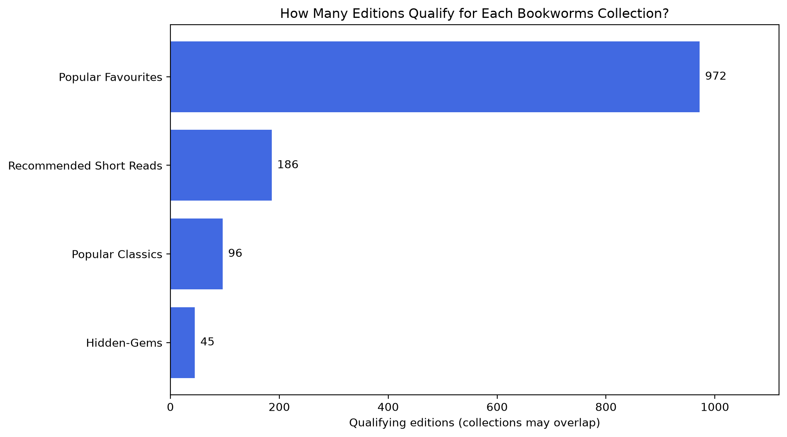
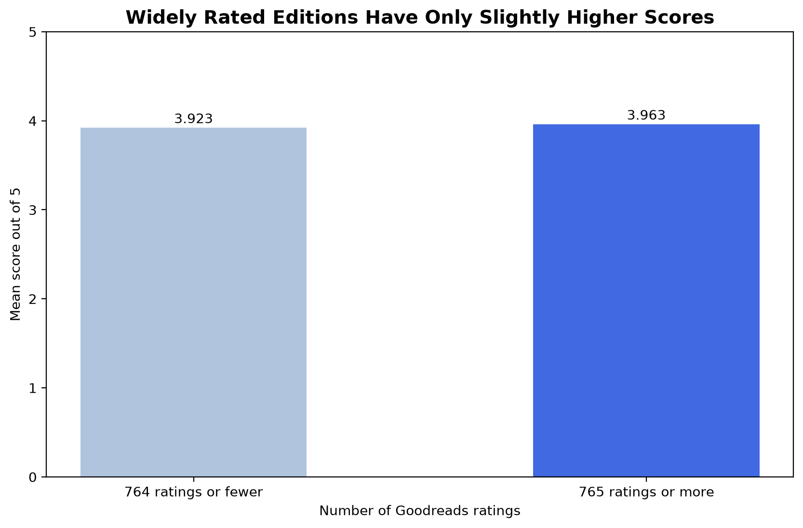

# Bookworms - Choosing Books for Monthly Subscription Boxes
>>>>>>> origin/preeti

**Group 4:** + Preeti Tewatia + Telma Guerreiro + Cem Kocyigit  
**Ironhack Data Analytics - First Project: SQL, From Data to Insight**

Bookworms is a fictional online book subscription company. Customers choose a collection and reading language, and receive a box of books selected by the company each month. The company also recommends and sells books.

We used Goodreads data to prepare collection shortlists and investigate ratings, author entries, book length and publication period.

Our rules return **1,253 distinct book records across four collections**. The more widely rated half of the rated dataset scored only **0.04 points higher on average** than the other half. That gave us little reason to choose on popularity alone.

The output is a set of candidates to review, not a sales forecast or a final purchasing list.

## 1. Business problem and scope

**Main question: Which books should Bookworms consider for its launch collections?**

A book with a score of 5.0 from two ratings is not automatically a stronger choice than one rated 4.5 by thousands of readers. Average rating and rating count answer different questions: how a record was rated, and how much rating activity it received.

We began with three collections and later added **Popular Classics**. The four collections in the final analysis are:

| Collection | What it is intended to offer |
| --- | --- |
| Popular Favourites | Well-rated books with substantial rating activity. |
| Recommended Short Reads | Well-rated shorter books with a minimum amount of feedback. |
| Hidden-Gem Candidates | High-scoring books with comparatively fewer ratings. |
| Popular Classics | Well-rated records with an older reported publication year, subject to further review of classic status. |

The analysis grew from three collections to four. "Recommended Short Reads" replaces the earlier label "Highly Rated Short Reads," and the rules below replace the trial thresholds.

All four filters use **English-language records**. This is an analysis scope decision, not evidence that customers prefer English.

### Who would use the results?

| Stakeholder | Decision supported |
| --- | --- |
| Business owner | Approve the collection offer and decide what to test before launch. |
| Content/recommendation team | Review candidate books and their suitability for each collection. |
| Purchasing team | Check exact editions, supplier availability and purchasing costs. |
| Marketing team | Explain the differences between the collections without making unsupported claims. |
| Customer experience team | Consider whether the choices suit subscribers and gather feedback. |

Genres and individual customer preferences are not in this dataset. We discussed adding genres, but they were not included in the final rules. This is a collection-selection project, not a personalized recommendation engine.

## 2. Questions and starting hypotheses

The business plan gave us four hypotheses to explore. They were starting ideas, not conclusions to prove.

| Hypothesis | Question | Approach used in the current analysis |
| --- | --- | --- |
| H1 - Ratings and popularity | Do records with more Goodreads ratings have higher average scores? | Split rated records at the median rating count and compare the two mean scores. |
| H2 - Author consistency | Do some author entries have several records that consistently score above the overall benchmark? | Group stored author labels and compare their median scores and consistency, using minimum record and rating-count requirements. |
| H3 - Book length | Do average scores differ between shorter and longer books? | Compare mean scores across three page ranges. |
| H4 - Publication period | Do ratings and rating activity differ across publication periods? | Compare mean scores and median rating counts by reported publication decade. |

For H1, the final analysis uses the two-group comparison rather than the correlation proposed initially. Written-review counts are retained, but we do not report a separate written-review finding.

These are **descriptive comparisons**, not proof of causation or statistical significance.

## 3. Dataset

The historical Goodreads dataset was selected from the course's Kaggle options. Its original description identifies the Goodreads API as the collection source. The exact download URL and dataset usage terms still need to be recorded; no data license is assumed here.

| Item | Current analysis data |
| --- | --- |
| Records | 11,123 |
| Distinct source `bookID` values | 11,123 |
| Fields in the cleaned CSV | 13: the original 12 plus `publication_year` |
| English-coded records | 10,537, or 94.7% |
| Missing page counts after cleaning | 76 |
| Missing average ratings after cleaning | 26 |
| Missing contributor fields after cleaning | 5 |

A row is a **book or edition record**, not necessarily a different work. Repeated titles were retained because they can represent different editions, translations or formats.

### Fields and their uses

| Fields | Use |
| --- | --- |
| `bookID`, `title` | Identify and describe the source record. |
| `authors` | Contributor text, including entries with several slash-separated names. |
| `average_rating`, `ratings_count` | Reader score and rating activity used in selection and analysis. |
| `text_reviews_count` | Number of written reviews; retained for reference and database storage. |
| `num_pages`, `language_code` | Collection suitability and reading-language filtering. |
| `publication_date`, `publication_year` | Source date text and extracted year used in period analysis. |
| `isbn`, `isbn13` | Edition identifiers, read as text to preserve leading zeros and letter characters. |
| `publisher` | Publisher information and additional context for checking formats. |

The earlier Excel reference was reported as having **11,127 records**. The CSV notebook reports 11,119 parsed rows plus four repairs: **11,123**. That source-version difference remains unresolved, not an established intentional deletion. All results here use the 11,123-record CSV.

## 4. Data preparation

The final cleaning workflow is saved in **`bookworms_data_cleaning_final.ipynb`**. It reads original `books.csv` from data/raw and exports the cleaned data to data/clean.

The input and output are in the current working folder in this version. Its main cleaning decisions were:

| Issue or check | Treatment and reason |
| --- | --- |
| Four malformed rows contained an extra field. | Repair the split contributor text and retain the records.|
| Spaces in column headings and around titles. | Strip unnecessary outside spaces, including the spaces before `num_pages`. |
| Numeric values imported as text. | Convert IDs and counts to integers and average ratings to decimal values; retain ISBNs as text. |
| Duplicate records or IDs. | Check both; the notebook reports no fully duplicated rows or duplicate source book IDs. |
| Zero page counts. | Treat 76 values as missing or not applicable rather than as real zero-page books. |
| Zero average ratings. | Treat 26 scores as missing because those records also have zero recorded ratings. |
| Very large or small page counts. | Inspect rather than automatically delete: large values can describe sets or reference books, while some very small values appear to describe audio editions. |
| Different English-language codes. | Map `en-US`, `en-GB` and `en-CA` to `eng` for the broad language filter. |
| Publisher variants. | Apply `publisher_corrections` to the `publisher` column; these groups are an analytical choice, not a verified corporate-ownership classification. |
| contributor Placeholders. | Replace  five `NOT A BOOK` values with missing values while retaining the book records. |
| Publication information. | Extract `publication_year`, check for blank or missing years, and convert it to an integer. |

Two source strings contain invalid full dates, but their reported years can still be extracted. The year-based analysis uses these reported years, and the database stores `publication_year`.

### Contributor detail and author summaries

Author grouping can combine or shorten contributor labels. The H2 results therefore describe grouped author entries. Reproducing those results requires the same grouping rules in the exploration notebook. The database population notebook splits the contributor text available in the cleaned CSV into author records and book-author links.

The cleaned dataset used to verify the figures in this README is `data/clean/bookworms_cleaned_data_final.csv`. Both the exploration and database population notebooks should read this same dataset. When regenerating the export, keep their CSV input paths aligned with the cleaning notebook's output path.

## 5. Database design

We moved from one flat file to five related tables. Two linking tables handle the cases where a book has several contributors or qualifies for several collections.

| Table | Purpose | Primary key |
| --- | --- | --- |
| `books` | Book details, reader scores, counts, and publication year. | `book_id` |
| `authors` | Author/contributor records. | `author_id` |
| `book_authors` | Connect books to contributor records. | `book_id` + `author_id` |
| `collections` | Collection definitions. | `collection_id` |
| `collection_of_books` | Connect books to collections. | `collection_id` + `book_id` |

Each linking table has **one composite primary key** made from its two IDs. Both IDs are foreign keys. The combination must be unique, but each ID can appear in several links.

The four relationships are `books` **1:N** `book_authors`, `authors` **1:N** `book_authors`, `books` **1:N** `collection_of_books`, and `collections` **1:N** `collection_of_books`.


### MySQL `books` table

| Column | Type | Allows NULL |
| --- | --- | --- |
| `book_id` | `INT`, primary key | No |
| `title` | `TEXT` | No |
| `average_rating` | `DECIMAL(3,2)` | Yes |
| `language_code` | `VARCHAR(20)` | No |
| `num_pages` | `INT` | Yes |
| `ratings_count` | `INT` | No |
| `text_reviews_count` | `INT` | No |
| `publication_year` | `INT` | Yes |

During data cleaning, we extracted the edition's publication year from the source date. MySQL stores this cleaned `publication_year` so SQL and Python can use the same field for year-based analysis, such as finding editions published before 1976.

The `book_id` preserves the original Goodreads ID from the CSV.

## 6. SQL implementation and checks

The MySQL database is named `bookworms_new`. Create its five tables using `sql_scripts/create_bookworms_new.sql`, then populate them using [`notebooks/database_population.ipynb`](notebooks/database_population.ipynb). The notebook connects to MySQL through SQLAlchemy and PyMySQL.

The loading procedure:

1. Inserts selected CSV fields into `books`, preserving the source Goodreads ID as `book_id`.
2. Splits slash-separated contributor names, creates author IDs and inserts the corresponding `book_authors` links.
3. Stores the four collection definitions and inserts matching book-collection pairs into `collection_of_books`.

Missing scores and page counts are stored as SQL `NULL`. The schema also allows missing publication years. Composite primary keys prevent duplicate pairs in the linking tables, and foreign keys enforce the relationships.


### Full catalogue and English-only reporting

The database contains all languages. Its saved collection memberships use the rating, page and year rules. Analytical queries apply **`books.language_code = 'eng'`** before reporting the English collection results.

| Collection | Stored memberships across all languages | English editions in the reports |
| --- | ---: | ---: |
| Popular Favourites | 976 | 972 |
| Recommended Short Reads | 187 | 186 |
| Hidden-Gem Candidates | 46 | 45 |
| Popular Classics | 105 | 96 |

The SQL query file is `sql_scripts/query_bookworms_new.sql`. It demonstrates joins, aggregations, subqueries and window functions, and documents the English filter. It also compares the English counts with the Python results. The additional reports show overlap between collection pairs and limited reader feedback among Classics candidates.

Check the table definitions directly in MySQL:

```sql
SHOW TABLES FROM bookworms_new;
SHOW COLUMNS FROM bookworms_new.books;
SHOW CREATE TABLE bookworms_new.authors;
SHOW CREATE TABLE bookworms_new.collection_of_books;
```

The population notebook includes a CSV-to-database book-count check and collection membership counts. Run the analytical SQL reports to compare the English-only results with the Python analysis. The MySQL screenshots document the schema. `sql_scripts/bookworms_new_dump.sql` is an exported snapshot of the database for sharing and importing on another machine.

## 7. Collection rules and results

All four filters require `language_code == "eng"`. Thresholds are inclusive where shown. They are the current project rules, not proven commercial optima or guarantees that a rating is reliable.

| Collection | Minimum average rating | Rating count | Other condition | Qualifying records |
| --- | ---: | --- | --- | ---: |
| Popular Favourites | 4.0 | At least 10,000 | None | 972 |
| Recommended Short Reads | 4.0 | At least 500 | More than 2 and no more than 100 pages | 186 |
| Hidden-Gem Candidates | 4.5 | 100-999 | None | 45 |
| Popular Classics | 4.0 | No minimum | Reported publication year before 1976 | 96 |



The counts total **1,299 memberships across 1,253 distinct book IDs**. Overlaps are 39 Popular/Short, three Popular/Classics and four Short/Classics, with no triple overlaps. They explain the 46 extra memberships. Distinct IDs are still not necessarily distinct works.

### Examples of qualifying records

| Collection | Example | Source bookID | Score | Rating count | Relevant detail |
| --- | --- | ---: | ---: | ---: | --- |
| Popular Favourites | The Hobbit | 5907 | 4.27 | 2,530,894 | 366 pages |
| Recommended Short Reads | Calvin and Hobbes: Sunday Pages 1985-1995: An Exhibition Catalogue | 24820 | 4.71 | 3,613 | 96 pages |
| Hidden-Gem Candidates | Early Color | 6550 | 4.73 | 144 | 156 pages |
| Popular Classics | The Power Broker | 1111 | 4.51 | 11,208 | Reported year 1975 |

These are qualifying examples, not ranked recommendations or approved purchases. The Power Broker also qualifies for Popular Favourites. Each example refers to the specific source record.

## 8. Python analysis and findings

For H1-H4, a **rated record** has a nonmissing average score and a positive rating count. There are **11,042** such records. These comparisons use all languages, unlike the English-only collection filters.

### H1 - More ratings did not mean a much higher score

Splitting at the median rating count of **764.5** created two equal groups:

| Group | Records | Mean score |
| --- | ---: | ---: |
| 764 ratings or fewer | 5,521 | 3.923 |
| 765 ratings or more | 5,521 | 3.963 |



The **0.04-point gap** gives limited descriptive support for H1, not a strong difference. Each record contributes one average score; these means are not weighted by rating count.

### H2 - Some grouped author entries were consistently above the benchmark

The reported H2 analysis groups the stored `authors` labels in `bookworms_cleaned_data_file (1).csv`, where both grouping dictionaries had been applied, and compares them with the rated catalog median of **3.96**. An entry qualified with at least three rated records, at least 1,000 ratings in total, a median score above 3.96, and at least 75% of its records above 3.96.

That grouped-label version produces **212 qualifying entries**, as reported in the presentation:

| Example entry | Rated records | Median score | Records above 3.96 |
| --- | ---: | ---: | ---: |
| Bill Watterson | 7 | 4.71 | 100% |
| J.R.R. Tolkien | 25 | 4.44 | 96% |
| J.K. Rowling | 25 | 4.49 | 100% |

Contributor combinations follow the analysis grouping rules, and repeated editions can represent the same work. These examples should be reviewed before making recommendations about individual authors.

### H3 - Mean ratings were fairly close across page ranges

We excluded missing page counts and records with two pages or fewer, leaving **10,943 rated records**.

| Pages per record | Records | Mean score |
| --- | ---: | ---: |
| 3-100 | 921 | 3.968 |
| 101-400 | 7,034 | 3.907 |
| Over 400 | 2,988 | 4.021 |

The means differ but remain fairly close on the five-point scale. Length helps define a shorter-reading offer; it does not establish quality or cause a higher score.

### H4 - Feedback varied more than mean scores across decades

We used the reported publication year and displayed only decades with **at least 100 rated records**. This is a minimum group size, not a requirement that every book have 100 ratings.

| Publication decade | Rated records | Mean score | Median rating count |
| --- | ---: | ---: | ---: |
| 1970s | 203 | 3.960 | 226 |
| 1980s | 617 | 3.979 | 311 |
| 1990s | 2,449 | 3.954 | 641 |
| 2000s | 7,514 | 3.935 | 911 |
| 2010s | 137 | 3.981 | 775 |

Mean scores are similar. Median rating count peaks in the 2000s among the decades shown, but this is not evidence of current demand. Reported years may refer to editions, not first publication.

## 9. Key findings, recommendations and limitations

Our recommendation is to use the filters to narrow the choice, then review the actual books.

| Finding or limitation | Recommended action |
| --- | --- |
| The H1 mean-score difference is only about 0.04. | Consider average score and rating count together rather than treating popularity as a substitute for reader opinion. |
| Popular Favourites has the largest pool, with 972 candidates. | Use it as a practical starting point for editorial review, not a prediction that it will sell best. |
| Some low-page records are audio editions. | Verify format and edition before selecting physical books for the boxes. |
| Author labels may combine or simplify contributor credits. | Preserve the contributor links and review the grouped results before making individual-author recommendations. |
| Popular Classics has no rating-count minimum. | Review feedback and literary fit rather than treating an old reported year as proof of popularity or classic status. |
| No sales, subscriber, stock or cost data is available. | Check sourcing and costs, then test subscriber interest with a small pilot before committing to purchases. |

For example, source `bookID` 16 has six recorded pages and an audio publisher, yet passes the Short Reads numerical filter. In Classics, **22 of 96 candidates have fewer than 100 ratings, including one with zero**. These are reasons for a review step, not results we removed to make the lists look better.

The dataset is historical, not representative of every reader, and heavily English-coded. It contains no genres or subscriber preferences. We cannot use it to establish sales, profit, customer retention or personalized suitability. Repeated works and the treatment of contributor labels also affect record and author counts.

## 10. Tools and collaboration

- **Python, Pandas and NumPy** for data preparation and analysis.
- **Matplotlib and Jupyter Notebook** for charts and the documented workflow.
- **MySQL and MySQL Workbench** for the relational database and SQL analysis.
- **SQLAlchemy and PyMySQL** for loading DataFrames into MySQL.
- **Miro and DrawDB** for the database model and diagram.
- **Git and GitHub** for collaboration and version control.

The team worked across business planning, cleaning, database implementation, analysis and presentation, using personal branches and reviewing changes before merging into `main`.

## 11. Repository files and running instructions

### Main files

| File or folder | Role |
| --- | --- |
| `notebooks/bookworms_data_cleaning_final.ipynb` | Reads the raw data and exports the cleaned CSV. |
| `notebooks/database_population.ipynb` | Loads the five MySQL tables and checks the loaded counts. |
| `notebooks/explore_clean_data.ipynb` | Collection selection, hypothesis exploration and reported comparisons. |
| `data/raw/books.csv` | Original input for the cleaning notebook. |
| `data/clean/` | Cleaned CSV used by the analysis and population notebooks. The supplied analysis snapshot is `bookworms_cleaned_data_final.csv`. |
| `sql_scripts/create_bookworms_new.sql` | Database and table definitions. |
| `sql_scripts/query_bookworms_new.sql` | Analytical SQL queries with the English-language reporting filter. |
| `sql_scripts/bookworms_new_dump.sql` | Exported database snapshot. |
| `figures/` | Database model, diagrams and analysis charts. |
| `slides/Bookworms_g4_presentation.pptx` | Final project presentation. |

### Environment

Install MySQL and MySQL Workbench, then create a Python virtual environment and install the notebook dependencies:

```bash
python -m venv .venv
```

Activate the environment on Windows PowerShell:

```powershell
.\.venv\Scripts\Activate.ps1
```

On macOS or Linux:

```bash
source .venv/bin/activate
```

Install the Python packages:

```bash
python -m pip install pandas numpy matplotlib jupyter sqlalchemy pymysql
```

Use MySQL 8.0 or later for the CTEs and window functions in the analytical queries. Each team member uses their own local MySQL credentials.

### Running order

1. **Clean the data.** Open `notebooks/bookworms_data_cleaning_final.ipynb`, restart its kernel and run the cells in order. Its input is `../data/raw/books.csv` and its cleaned output belongs in `../data/clean/` when the notebook runs from `notebooks/`.
2. **Use the same cleaned dataset.** Set the CSV input paths in `explore_clean_data.ipynb` and `database_population.ipynb` to the cleaning export. The reported results use the supplied `bookworms_cleaned_data_file (1).csv` snapshot. CSV filenames, including spaces and suffixes, must match the paths in the code.
3. **Create the database.** Run `sql_scripts/create_bookworms_new.sql` in MySQL Workbench to create `bookworms_new` and its five tables.
4. **Populate the database.** Connect `database_population.ipynb` to `bookworms_new` using your local credentials, then run its preparation, population and verification cells. Run the population cell against empty tables. It appends rows, so rerunning after a successful load produces duplicate-key errors.
5. **Run the analysis.** Run `explore_clean_data.ipynb` from a fresh kernel, using the same cleaned data and author-grouping rules as the reported analysis.
6. **Run the SQL reports.** Open `sql_scripts/query_bookworms_new.sql` in MySQL Workbench. The queries apply the English filter to the stored memberships, and the expected collection counts are **972, 186, 45 and 96**.

The database dump provides a second setup route. Import `bookworms_new_dump.sql` into a fresh database in Workbench to restore the saved tables and records, then run the query file. Choose either the Python population route or the dump-import route for a given database.
